# Workshop 2 - HanziApp

| | |
|---|---|
| **Project** | HanziApp — web application for learning HSK 3.0 vocabulary (levels 1 to 6) with spaced repetition and writing practice |
| **Course** | Software Engineering II, 2026-II — Universidad Nacional de Colombia |
| **Profesora** | Eng. Liliana Marcela Olarte, M.Sc. |

**Team**

- Juan Pablo Zuluaga Galindo
- Camilo Andrés Salinas Cuervo
- Daniel Santiago Rincón Santofimio
- Nicolás Fuentes Ramos
- Luis Alejandro Sanchez

> Full report (all sections in a single document): [`Workshop2-HanziApp.pdf`](./Workshop2-HanziApp1.pdf)

HanziApp is a web application for learning Mandarin vocabulary (HSK levels) using active recall. This workshop documents the system domain, the main classes, the class diagram, the relational database model, and the screen mockups.

## Contents

1. [System Domain](#1-system-domain)
2. [CRC Cards](#2-crc-cards)
3. [Class Diagram](#3-class-diagram)
4. [Relational Database Model](#4-relational-database-model)
5. [Mockups](#5-mockups)

## Repository structure

```
Workshop-2/
├── README.md
├── Workshop2-HanziApp.pdf
├── Class-Diagram/
│   |
│   ├── class-01.png
│   ├── class-02.png
│   ├── class-03.png
│   ├── class-04.png
│   ├── class-05.png
│   ├── class-06.png
│   ├── class-07.png
│   └── 0class-08.png
├── Relational-Database-Model/
│   ├── er-01.png
│   ├── er-02.png
│   ├── er-03.png
│   ├── er-04png
│   ├── er-05.png
│   ├── er-06.png
│   └── er-07.png
└── Mock-ups/
    └── 1.png … 11.png
```

---

## 1. System Domain

Full details in section 1 of the [PDF](./Workshop2-HanziApp1.pdf).

- **System context:** _(summary from the PDF)_
- **Actor characterization:** _(actors and their roles)_
- **Business rules:** _(list of rules)_

## 2. CRC Cards

One card per main class, with its responsibilities and collaborators. The full set is in section 2 of the [PDF](./Workshop2-HanziApp1.pdf).


## 3. Class Diagram

UML class diagrams with attributes, methods, and relationships, split by module. Notation reference: [UML Class Diagrams Overview](https://www.uml-diagrams.org/class-diagrams-overview.html).


## 4. Relational Database Model

Schema with tables, primary and foreign keys, and relationships, split by module.


## 5. Mockups

Wireframes of the application screens. Full detail in section 5 of the [PDF](./Workshop2-HanziApp1.pdf).

**Mockup 1**

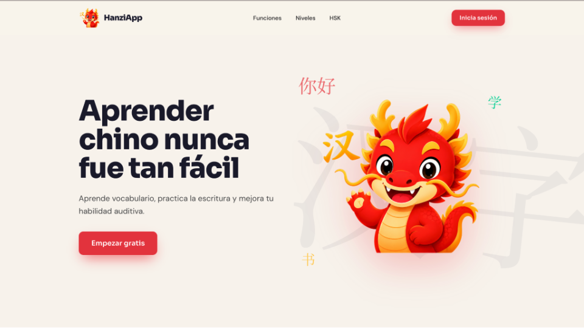

**Mockup 2**

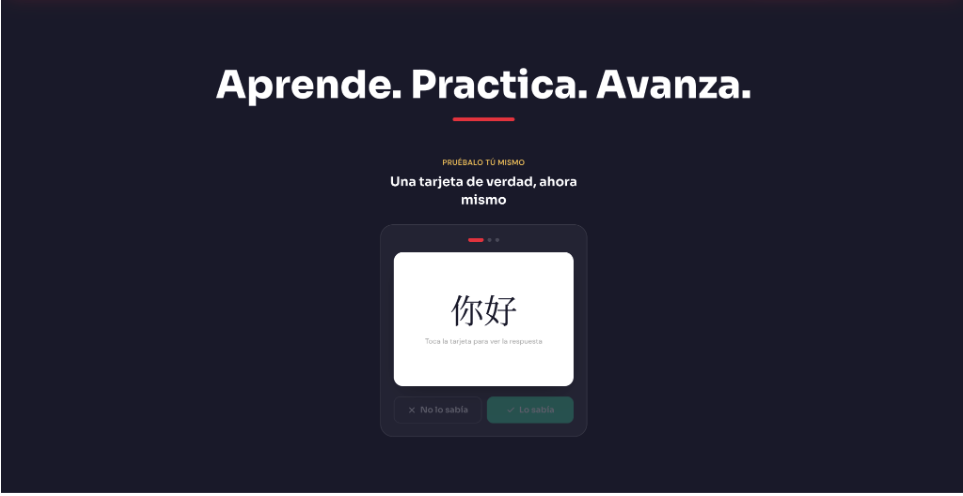

**Mockup 3**

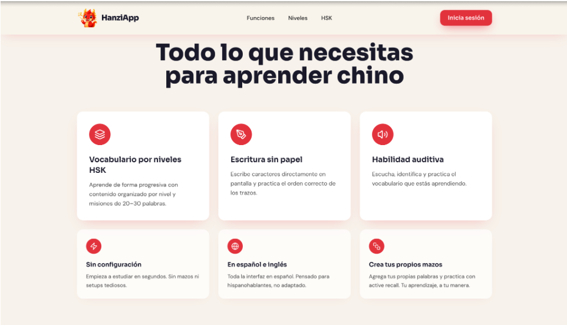

**Mockup 4**

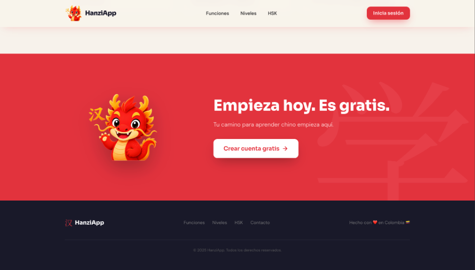

**Mockup 5**

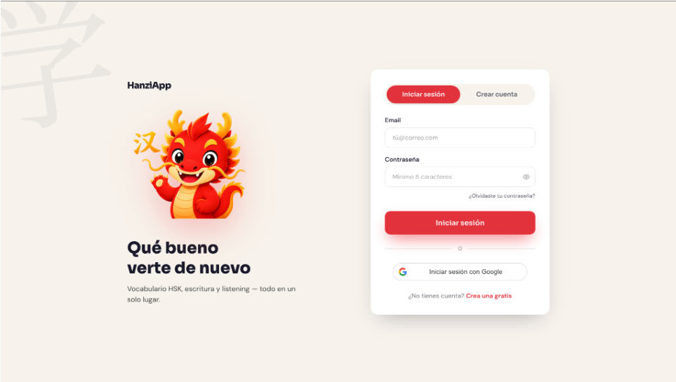

**Mockup 6**

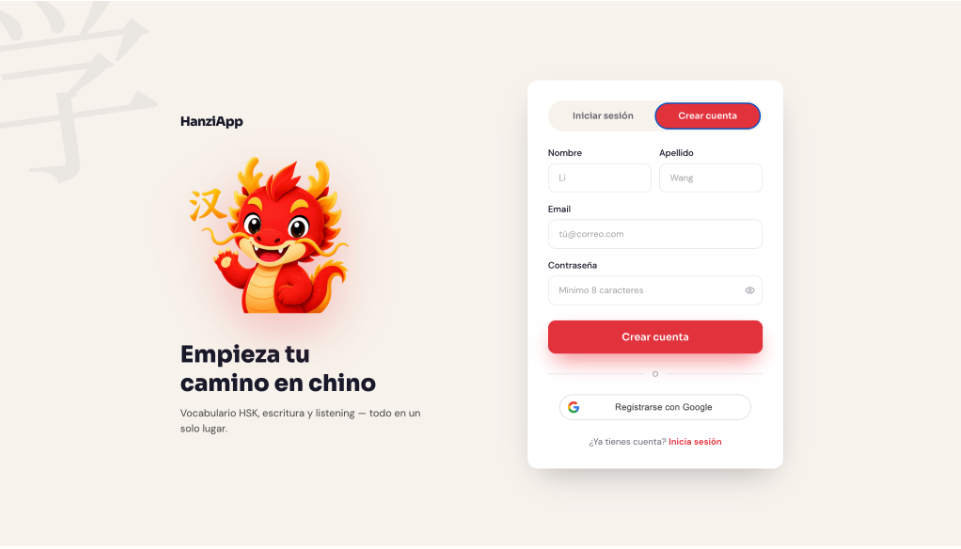

**Mockup 7**

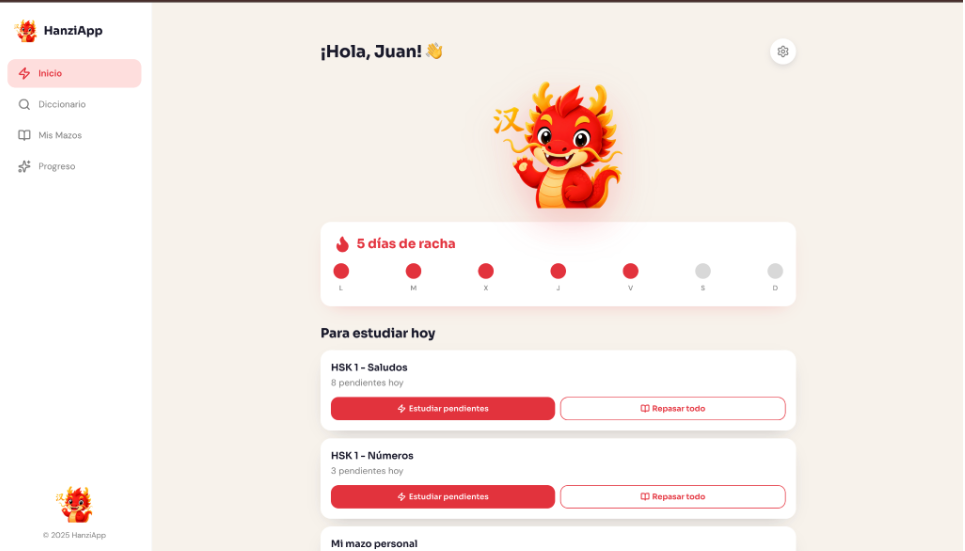

**Mockup 8**

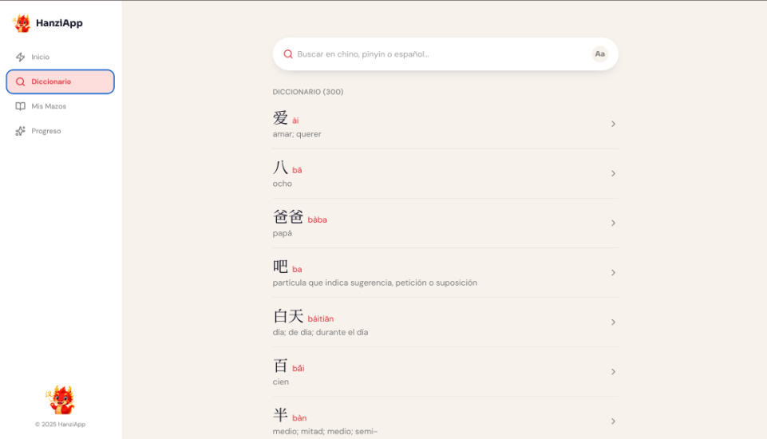

**Mockup 9**

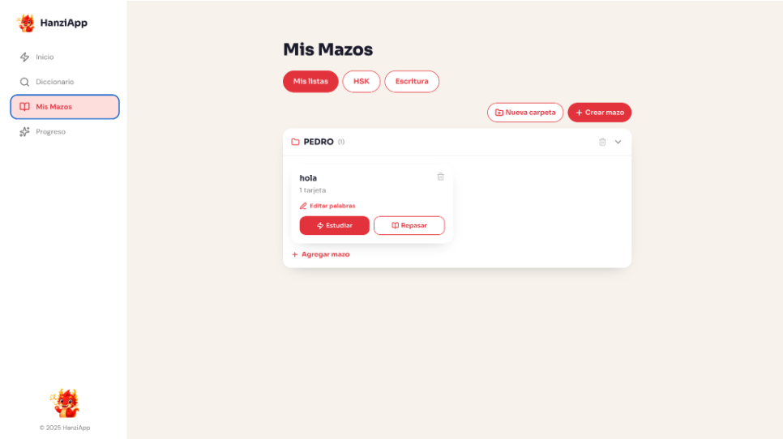

**Mockup 10**

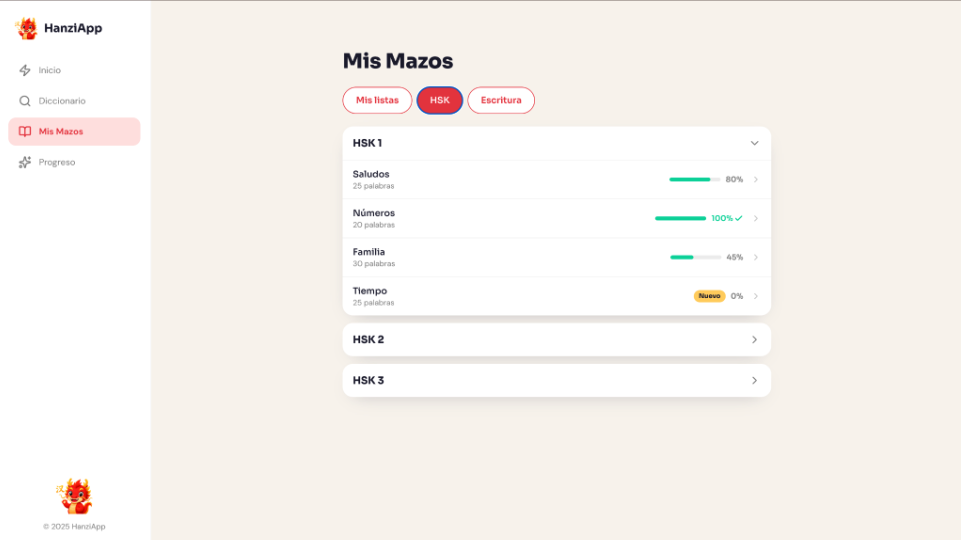

**Mockup 11**

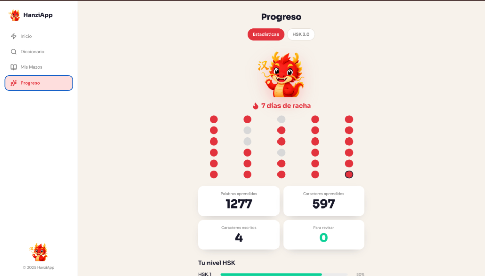
