# Workshop 2 — HanziApp

| | |
|---|---|
| **Project** | HanziApp — web application for learning HSK 3.0 vocabulary (levels 1 to 6) with spaced repetition and writing practice |
| **Course** | Software Engineering II, 2026-II — Universidad Nacional de Colombia |
| **Profesora** | Eng. Liliana Marcela Olarte, M.Sc. |

**Team**

- Juan Pablo Zuluaga Galindo
- Camilo Andrés Salinas Cuervo
- Daniel Santiago Rincón Santofimio
- Nicolás Fuentes Ramos
- Luis Alejandro Sanchez

> Full report (all sections in a single document): [`Workshop2-HanziApp.pdf`](./Workshop2-HanziApp.pdf)

HanziApp is a Spanish-language web application for learning Mandarin vocabulary (HSK levels) using active recall. This workshop documents the system domain, the main classes, the class diagram, the relational database model, and the screen mockups.

## Contents

1. [System Domain](#1-system-domain)
2. [CRC Cards](#2-crc-cards)
3. [Class Diagram](#3-class-diagram)
4. [Relational Database Model](#4-relational-database-model)
5. [Mockups](#5-mockups)

## Repository structure

```
Workshop-2/
├── README.md
├── Workshop2-HanziApp.pdf
├── Class-Diagram/
│   ├── 00-overview.png
│   ├── 01-accounts.png
│   ├── 02-content.png
│   ├── 03-content-management.png
│   ├── 04-organization-courses.png
│   ├── 05-review-states.png
│   ├── 06-study-sessions.png
│   ├── 07-progress.png
│   └── 08-enumerations.png
├── Relational-Database-Model/
│   ├── 00-overview.png
│   ├── 00-overview-gv.png
│   ├── 01-accounts.png
│   ├── 02-content.png
│   ├── 03-content-management.png
│   ├── 04-organization-courses.png
│   └── 05-learning-progress.png
└── Mock-ups/
    └── 1.png … 11.png
```

---

## 1. System Domain

Full details in section 1 of the [PDF](./Workshop2-HanziApp.pdf).

- **System context:** _(summary from the PDF)_
- **Actor characterization:** _(actors and their roles)_
- **Business rules:** _(list of rules)_

## 2. CRC Cards

One card per main class, with its responsibilities and collaborators. The full set is in section 2 of the [PDF](./Workshop2-HanziApp.pdf).

| Class | Responsibilities | Collaborators |
|-------|------------------|---------------|
| _(Class)_ | _(...)_ | _(...)_ |

## 3. Class Diagram

UML class diagrams with attributes, methods, and relationships, split by module. Notation reference: [UML Class Diagrams Overview](https://www.uml-diagrams.org/class-diagrams-overview.html).

| Diagram | Description |
|---------|-------------|
| [Overview](./Class-Diagram/00-overview.png) | General view of all classes and their relationships |
| [Accounts](./Class-Diagram/01-accounts.png) | User accounts and roles |
| [Content](./Class-Diagram/02-content.png) | Learning content (vocabulary and related entities) |
| [Content management](./Class-Diagram/03-content-management.png) | Content administration and curation |
| [Organization & courses](./Class-Diagram/04-organization-courses.png) | Organizations, courses, and enrollment |
| [Review states](./Class-Diagram/05-review-states.png) | Review states of each item for active recall |
| [Study sessions](./Class-Diagram/06-study-sessions.png) | Study sessions and their activity |
| [Progress](./Class-Diagram/07-progress.png) | Learner progress tracking |
| [Enumerations](./Class-Diagram/08-enumerations.png) | Enumerated types used across the model |

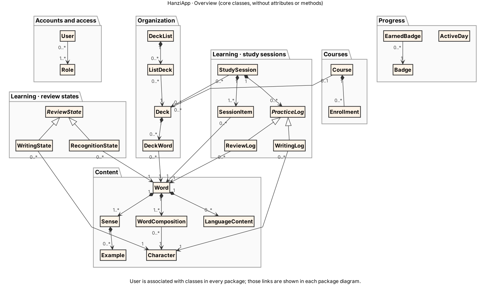

## 4. Relational Database Model

Schema with tables, primary and foreign keys, and relationships, split by module.

| Diagram | Description |
|---------|-------------|
| [Overview](./Relational-Database-Model/00-overview.png) | Complete ER diagram ([Graphviz version](./Relational-Database-Model/00-overview-gv.png)) |
| [Accounts](./Relational-Database-Model/01-accounts.png) | Accounts tables |
| [Content](./Relational-Database-Model/02-content.png) | Content tables |
| [Content management](./Relational-Database-Model/03-content-management.png) | Content management tables |
| [Organization & courses](./Relational-Database-Model/04-organization-courses.png) | Organization and course tables |
| [Learning progress](./Relational-Database-Model/05-learning-progress.png) | Review, session, and progress tables |

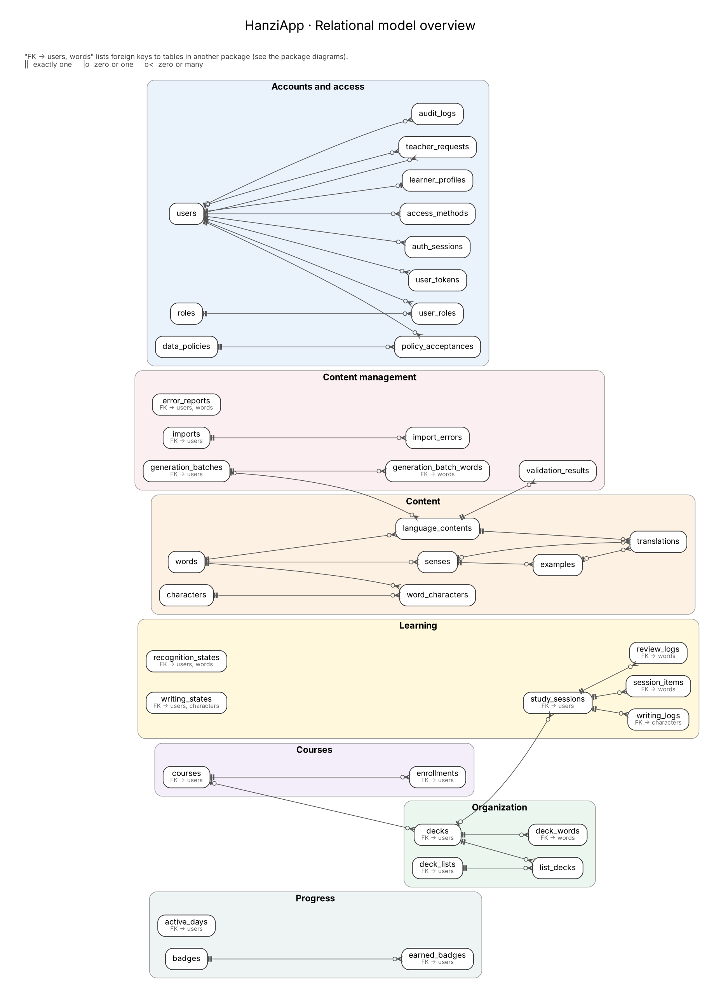

## 5. Mockups

Wireframes of the application screens. Full detail in section 5 of the [PDF](./Workshop2-HanziApp.pdf).

**Mockup 1**

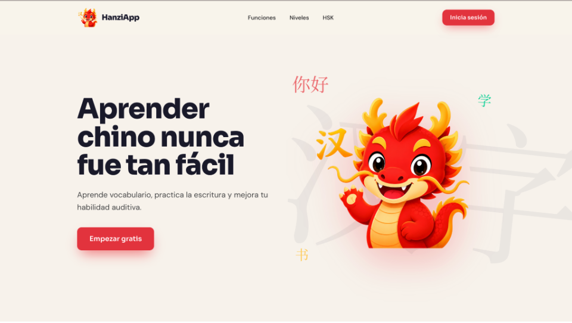

**Mockup 2**

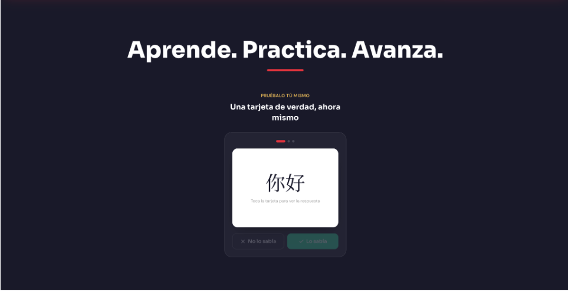

**Mockup 3**

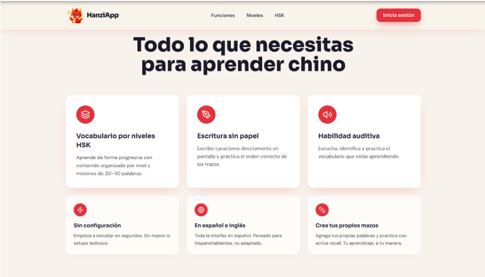

**Mockup 4**

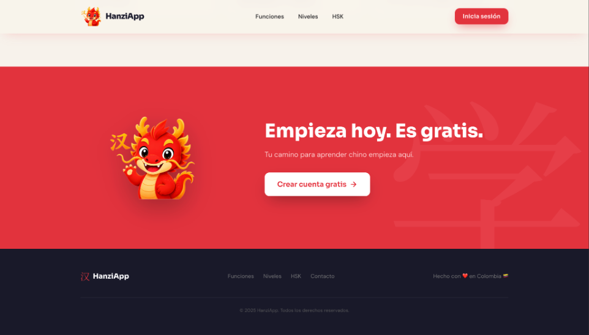

**Mockup 5**

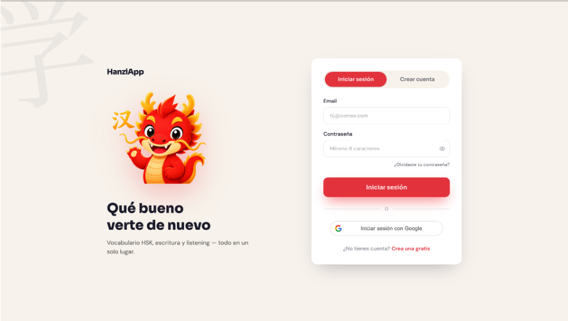

**Mockup 6**

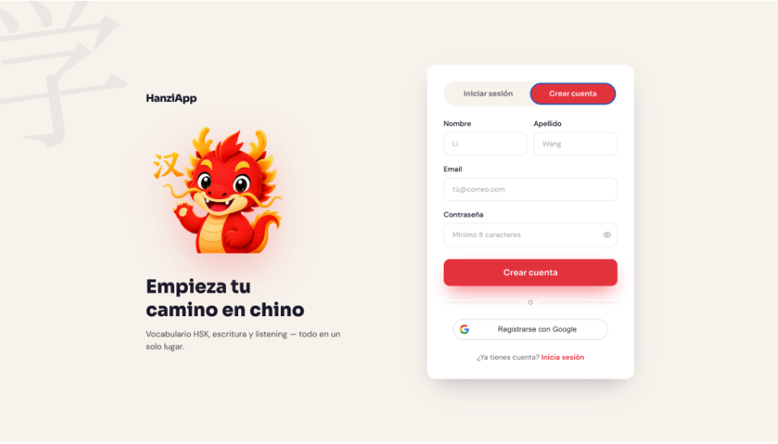

**Mockup 7**

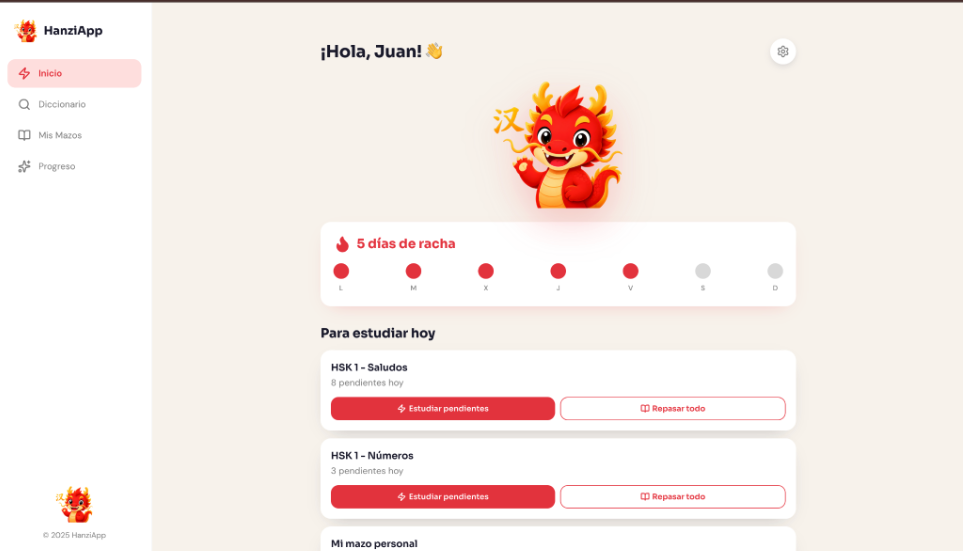

**Mockup 8**

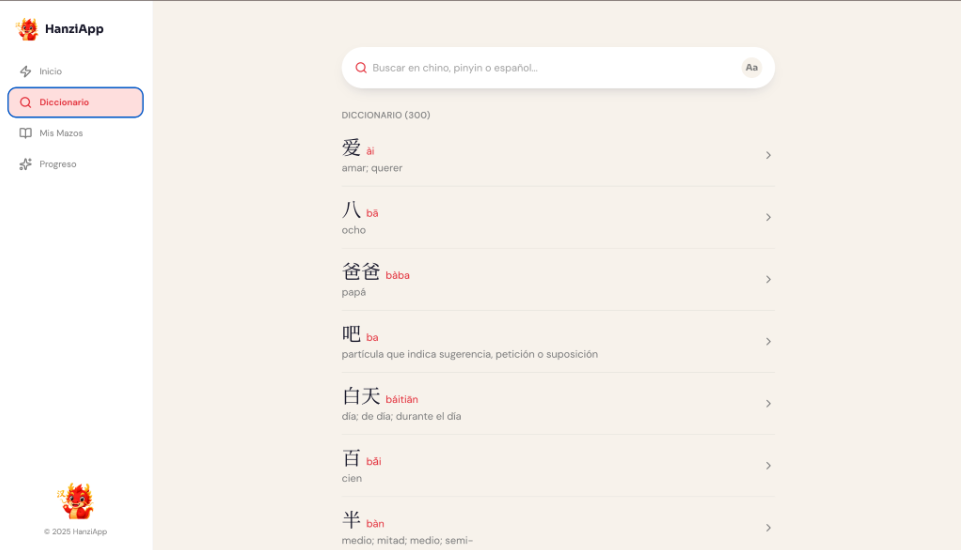

**Mockup 9**

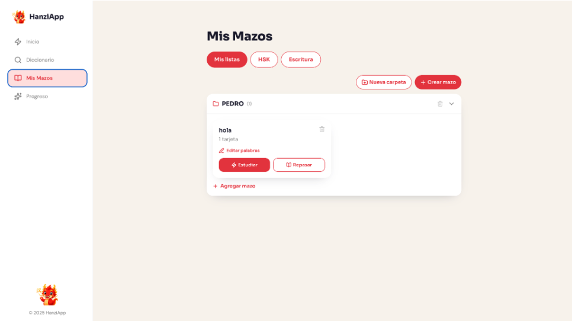

**Mockup 10**

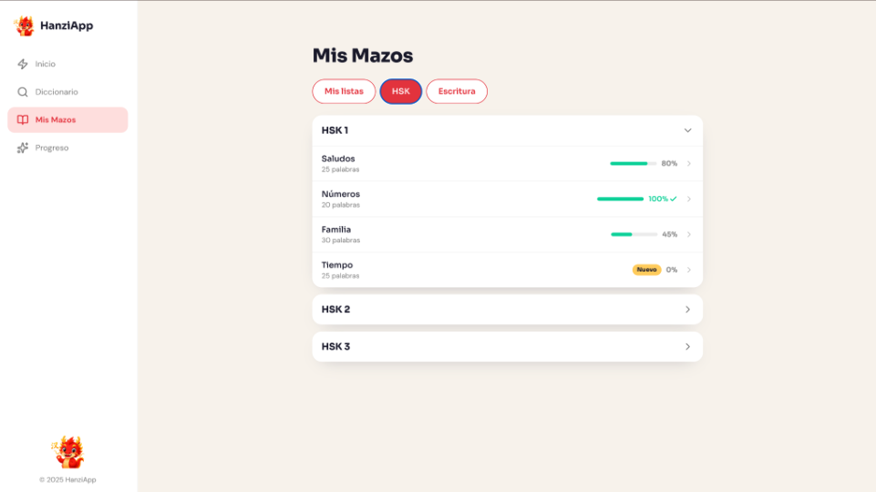

**Mockup 11**

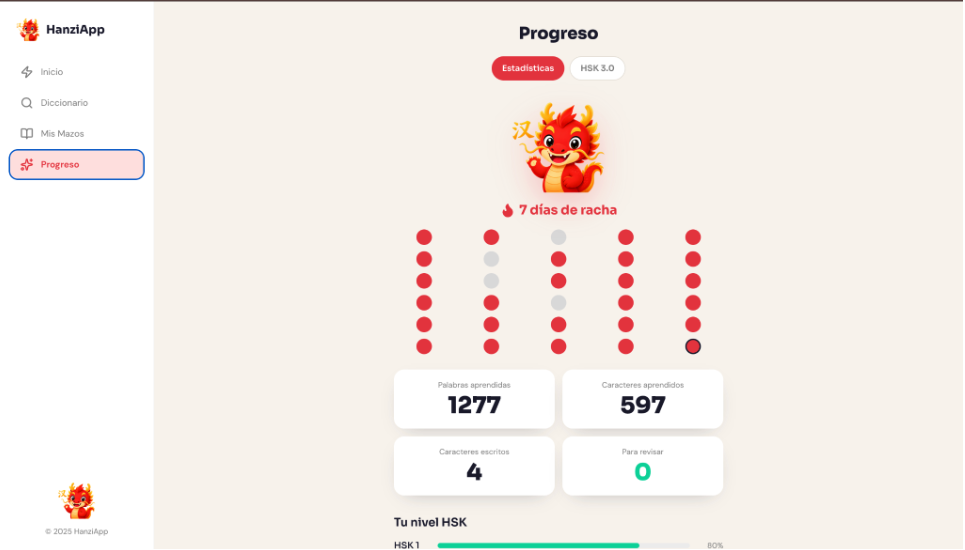
